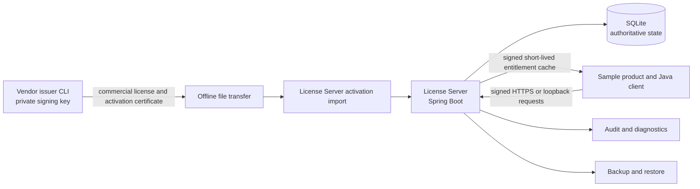
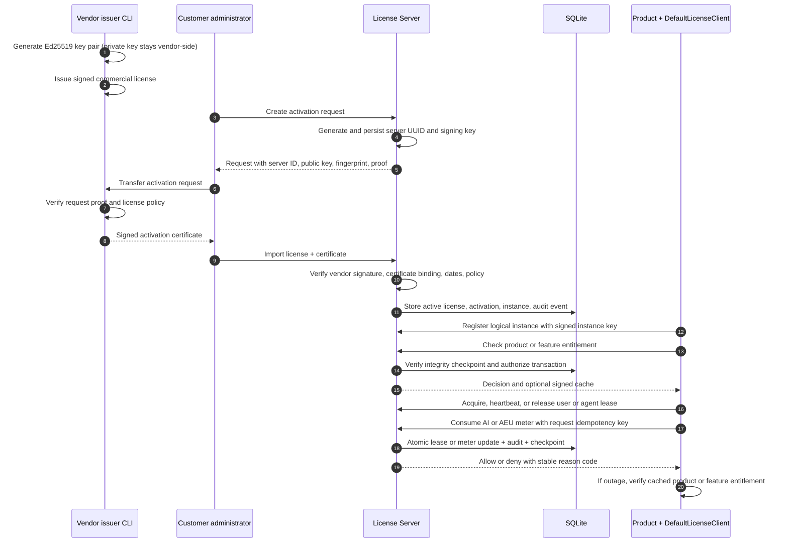

# Offline License Server POC: architecture, shipped artifacts, and demo narrative

This document is the end-to-end guide to what is shipped in the POC, how the pieces fit together, and what can be
demonstrated on a single developer machine. It complements the task-oriented [poc-demo.md](poc-demo.md), which contains
the exact command transcript.

## What the POC is

The POC is a customer-hosted Java 21 License Server with an embedded SQLite authoritative store. A vendor prepares a
commercial license and signs it offline. A customer generates an activation request on the intended server, obtains a
vendor-signed activation certificate through an offline transfer, and imports both artifacts. Product installations then
use a typed Java client and signed requests to ask the server for entitlements, leases, and metering decisions.

There are no vendor calls, Internet dependencies, PostgreSQL services, Docker images, or Kubernetes control-plane
components in this POC. Kubernetes is represented by a logical-instance adapter and shared durable identity, so the same
runtime semantics can be exercised locally.



## The main lifecycle



## Shipped modules

| Module | Responsibility | What a demo can show |
| --- | --- | --- |
| `license-model` | Immutable domain records, enums, validation limits, and the license JSON schema | Typed licenses, activation requests/certificates, leases, usage, and reason codes |
| `license-crypto` | Canonical JSON, Ed25519 verification, envelope codecs, activation proof, runtime and cached-entitlement verifiers | Tamper and wrong-key rejection without vendor private-key code in runtime modules |
| `license-crypto-vendor` | Vendor-only commercial-license and activation signing | Offline issuance boundary |
| `license-engine` | Activation/import, lifecycle, environment and DR policy, users/agents, leases, metering, trusted time, cache, audit | Business decisions and deterministic failure semantics |
| `license-storage` | SQLite schema/migrations, repositories, immediate transactions, checkpoints, backup/restore, durable identities | Restart persistence, contention safety, integrity and recovery checks |
| `license-server` | Spring Boot API, admin/runtime endpoints, authentication filters, transaction boundary, health/readiness | The runnable License Server |
| `license-client-java` | Signed request factory, HTTPS/pinned transport, local loopback mode, file cache, lease managers | Product integration without direct database access |
| `license-issuer-cli` | Executable issuer and inspection commands | Key generation, issue, verify, inspect, activate |
| `license-testkit` | Fixtures, temporary SQLite, concurrency harness, acceptance/security/outage tests | Repeatable proof of the acceptance criteria |
| `examples/sample-product` | Runnable product workflow | Status, registration, entitlement, user lease, agent lease, AI meter, cleanup |
| `examples/tomcat-example` | Servlet lifecycle adapter | Tomcat integration shape |
| `examples/kubernetes-example` | Shared durable logical identity and replica simulator | Replica restarts do not create extra logical environments |

## Runtime boundaries and trust model

* Vendor private keys are used only by `license-crypto-vendor` and the issuer CLI. The server and product receive public
  verification material only.
* The server creates a stable installation identity in `identity.json`; the product creates a durable instance identity.
  Activation certificates bind the license to server UUID and server public-key fingerprint.
* Every runtime request is signed over method, path, timestamp, nonce, and body. The server enforces a five-minute clock
  window and one-use nonce. Admin endpoints separately require a bearer token; production mode requires TLS.
* Before a request, the transaction boundary verifies the authoritative-state checkpoint. Mutations run in SQLite
  `BEGIN IMMEDIATE`, append an audit record, and seal a new checkpoint before commit.

## What is authoritative

SQLite stores the active commercial license and activation, registered environments/instances, product and feature
entitlements, user and agent leases, AEU/AI counters, idempotency records, trusted-time checkpoints, audit chain, and
DR state. Repositories are behind ports so a future transactional database can replace SQLite without changing the
product-facing API. SQLite is deliberately the only persistence implementation shipped by this POC.

Lease acquisition, heartbeat, release, and metering are conditional updates. A full user or agent pool is not bypassed by
parallel requests, and retrying a request with the same idempotency key does not double-consume usage. Meter periods are
UTC calendar periods and action weights come from configuration.

## Offline and outage behavior

The server can issue a signed cache containing products, features, instance binding, issue time, expiry, and permitted
offline operations. The client encrypts that cache with AES-GCM using material derived from the product instance key and
verifies the server signature and pinned public key. During a server outage, only product/feature checks within the cache
expiry/grace window are available. New environment registration, named-user login, agent execution, lease allocation, and
AI/AEU consumption remain central-authority operations; the POC grants no offline AEU allowance.

Trusted time combines signed highest-seen checkpoints with the local clock. A rollback beyond the tolerance is rejected,
which prevents extending an expired entitlement by simply setting the host clock backward. State-integrity checkpoints
cover protected tables and are signed with the installation key; recovery diagnostics and readiness expose a degraded or
tampered state.

## DR, backup, and Kubernetes semantics

Instances have explicit `REGISTERED`, `STANDBY`, `ACTIVE`, and `DECOMMISSIONED` states. `switchActive` is an atomic
failover/failback operation and is audited. Backups use SQLite `VACUUM INTO`; restore stages the file, runs integrity and
identity checks, and only then replaces the active database through the authenticated operational path.

The Kubernetes example models one logical product installation with a shared durable identity mounted by replicas.
Replica churn therefore does not consume additional environment capacity. It is a simulator, not a Kubernetes operator or
container deployment, and it does not claim to protect secrets from a cluster administrator.

## Local demo: what to run

From the repository root:

```bash
./scripts/build-local.sh
./scripts/poc-demo-local.sh
```

The demo script builds the shaded issuer CLI and server, creates a temporary state directory, issues the sample
license, starts the server in loopback mode, performs activation, and runs the sample product. Its checks cover:

1. unactivated status and offline activation-request generation;
2. vendor issue/verify/inspect and activation import;
3. environment registration and product/feature entitlement checks;
4. user lease, agent execution lease, heartbeat/release, and pool-denial behavior;
5. AI/AEU meter consumption, idempotent retry, and limit denial;
6. signed cached-entitlement creation and outage verification;
7. audit/reason-code output, backup, restore validation, and clean shutdown.

Useful focused entry points are `run-license-server-local.sh`, `run-sample-product-local.sh`, `customer-cli.sh`,
`backup-license-server.sh`, `restore-license-server.sh`, and `verify-runtime-artifacts.sh`. The latter scans packaged
runtime archives and dependency graphs to demonstrate that vendor signing classes and private-key material are not pulled
into runtime artifacts.

## Build and shipped operational artifacts

`mvn clean test` builds all modules and runs the unit, integration, concurrency, security, outage, and artifact-isolation
tests. The issuer module produces a shaded executable JAR. The server module produces the runnable Spring Boot JAR.
Local scripts package these outputs under a temporary or selected state directory; they do not require Docker, a database
service, or Internet access after Maven dependencies are available.

Configuration is supplied by `deployment/local/application-local.yml` and environment variables for paths, ports,
admin token, trusted vendor key, clock tolerance, cache lifetime, lease durations, and meter weights. For a real customer
deployment, use TLS, an external secret-management process, restrictive filesystem permissions, scheduled backups, and
operator-controlled key rotation; the local profile intentionally uses loopback HTTP to keep the demo easy to run.

## What this POC proves—and what it does not

It proves the observable licensing workflow: offline cryptographic issuance and activation binding, signed runtime
authentication with replay protection, atomic pools and metering, durable identities, trusted-time and integrity checks,
short-lived cached entitlement verification, auditable DR transitions, and a usable Java integration surface.

It does not provide hardware-backed non-exportable keys, protection from a customer with root/cluster-admin/database access
who patches the client or server, active/active consensus, PostgreSQL, container images, or a production Kubernetes
operator. Those boundaries are intentional and are assessed in the [security-red-team-review.md](security-red-team-review.md).

For the acceptance-level behavior behind each section, see [trust-model.md](trust-model.md), [failure-semantics.md](failure-semantics.md), and [audit-and-diagnostics.md](audit-and-diagnostics.md).
