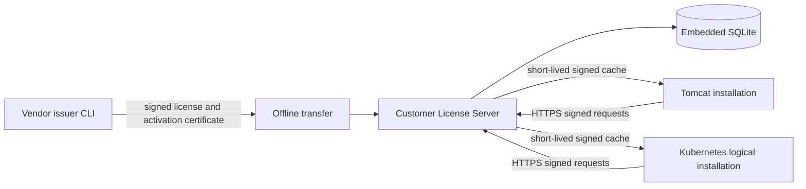

# Architecture

The POC is a customer-hosted Java 21 service with one embedded SQLite database. It runs as a local process and makes no vendor or Internet calls. Product installations use the typed Java client over the customer's internal network; business code never reads commercial-license JSON.

The model, runtime crypto, vendor-only crypto, engine, storage, server, Java client, issuer CLI, testkit, and examples are separate Maven modules. Vendor signing code exists only in `license-crypto-vendor` and the issuer CLI. SQLite `BEGIN IMMEDIATE` transactions serialize final-slot decisions. Repository ports permit a future HA database implementation without changing product APIs.

The POC intentionally does not solve active/active HA. One authoritative process and database file must be active. Future HA requires a consensus-backed transactional store and a non-exportable or quorum-controlled server signing identity.
