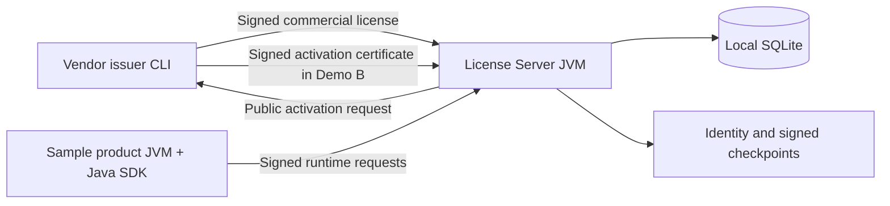

# Local run and demo guide

This guide gives two complete local demo paths for the offline License Server POC:

1. **License-validation-only mode**: import the vendor-signed commercial license directly; no vendor activation
   certificate is exchanged.
2. **Activation-required mode**: generate an installation request, have the vendor sign an activation certificate, and
   import both artifacts.

Use a fresh state directory for each path. The SQLite database and server identity are intentionally persistent, so
reusing them demonstrates restart behavior rather than a clean installation. Both paths use the same product JVM and
Java client after the license is registered.

## What runs on your laptop



| Component | Role | Local artifact |
| --- | --- | --- |
| Vendor CLI | Issue/verify licenses and installation activation certificates | `license-issuer-cli/target/license-issuer-cli.jar` |
| License Server | Enforce entitlements, allocate leases, record usage and audits | `license-server/target/license-server-1.0.0-SNAPSHOT.jar` |
| Java SDK | Sign product requests and verify cached entitlements | `license-client-java` embedded in the product |
| Sample product | Console workflow against the real server | `examples/sample-product/target/classes` plus reactor dependencies |
| SQLite and identity | Persist installation and accounting across restarts | Paths exported in section 2 |

The sample license represents A Inc., with 1 production instance, 1 passive DR instance, 2 UAT, 2 QA, and 5 development
instances. It permits 500 named users, 20 concurrent users, 10 registered agents, 3 concurrent agent executions,
and 100,000 monthly AI execution units. `VALIDATOR` includes TABLEAU, ORACLE_ANALYTICS, and COGNOS; DATA_MANAGER,
DATA_QUALITY, and DATA_FLOW are also enabled. Its validity is January 1, 2026 through December 31, 2030, with seven days
of grace. Outside that window, update the unsigned input and issue it again with the vendor CLI. Changing signed JSON
without issuing a new signature must fail.

## 1. Prerequisites and build

Install a JDK (Java 21 is the target), Maven 3.9+, `curl` supporting `--fail-with-body`, and `jq`.
Optional shell backup/restore helpers also require the `sqlite3` command; archive verification needs `jar` and `unzip`. The POC uses embedded SQLite and needs no PostgreSQL, Docker, Kubernetes,
external database, or Internet access after Maven dependencies are available.

All commands below run from the `offline-license-platform` directory. Use one terminal for the exported variables;
a new terminal must receive the same environment. The server runs in the background, and the sample product runs in the
foreground and exits after its workflow. This PoC exposes HTTP/JSON APIs and a console product, with no browser UI.

Check tools and align Maven and the shell to the same JDK:

```bash
java -version
mvn -version
curl --version
jq --version
# If needed on macOS, choose an installed JDK (prefer 21):
# export JAVA_HOME=$(/usr/libexec/java_home -v 21)
# export PATH="$JAVA_HOME/bin:$PATH"
```

From the repository root, build everything:

```bash
./scripts/build-local.sh
```

The build runs unit, integration, API, race, and process tests and produces the server and issuer JARs. It does not
install snapshot dependencies into the Maven local repository; the sample runner resolves them in a single reactor build.
The first build requires access to your Maven repository. Once all dependencies and build plugins have been staged,
`mvn -o clean verify` can verify the build without network access. The helper runners invoke Maven too, so rehearse them
before moving into an air gap.

Create the vendor key pair and sample signed license:

```bash
./scripts/generate-a-inc-license.sh "$PWD/.local/demo-vendor"
```

This creates a vendor private key, vendor public key, and
`samples/licenses/generated/a-inc-license.signed.json`. Keep the private key vendor-side; only the public key is
configured into the customer server.

### Script reference

| Script | What it runs and produces |
| --- | --- |
| `build-local.sh` | Full Maven reactor `clean verify`: tests and packaged server/issuer JARs. Test keys and certificates are temporary fixtures, not your persistent demo artifacts. |
| `generate-a-inc-license.sh [KEY_DIR]` | Issuer CLI `keygen` (if the private key does not already exist), `issue-license`, then `verify-license`. Default key directory: `.local/vendor`; this guide explicitly uses `.local/demo-vendor`. Output license: `samples/licenses/generated/a-inc-license.signed.json`. Does not issue activation certificates. |
| `run-license-server-local.sh` | Background `java -jar` server process, tracked under `.local/pids/license-server.pid`, logged to `.local/license-server/server.log`. The JVM creates/reuses its installation identity, database, and signed checkpoints. Does not vendor-sign a license or certificate. |
| `customer-cli.sh COMMAND` | Administrator HTTP calls: status, activation request, license/activation imports, instance/usage/audit inspection, handoffs, backup, and restore validation. An activation request is public identity/proof data, not a vendor-signed activation certificate. |
| `run-sample-product-local.sh` | Reactor packaging/classpath resolution, then the product JVM. Creates/reuses the product identity; registers and activates its instance, registers an agent, checks entitlements, acquires/releases leases, and meters usage. Does not issue vendor artifacts or automatically refresh an entitlement cache. |
| `poc-demo-local.sh [--list]` | Eight test groups covering 40 acceptance milestones. Test scenarios issue/sign temporary licenses and certificates; this is not a persistent server setup. `--list` only prints the narrative. |
| `verify-runtime-artifacts.sh` | Packages modules, resolves runtime dependency graphs, and scans seven runtime archives for vendor signing code, private-key markers, and default-secret markers. |
| `backup-license-server.sh TARGET` | Authenticated online database backup plus a `sqlite3` integrity check. Excludes the installation private key and external checkpoint files. Requires `sqlite3`. |
| `restore-license-server.sh BACKUP` | With the server stopped, checks the backup's SQLite consistency and original identity, preserves the previous database, and replaces the database. Startup still validates external checkpoints. Requires `sqlite3`. |
| `stop-local-processes.sh` | Stops tracked server/product PIDs, waits for shutdown, and removes their PID files. Preserves installation data and identities. |

All scripts are under `scripts/`. The build and runtime scripts do not perform the complete vendor/customer file exchange
automatically; Demo A and Demo B below provide the commands in order.

### Keys, licenses, activation certificates, and TLS

| Artifact | Created by | Signed/verified with | Purpose |
| --- | --- | --- | --- |
| Vendor Ed25519 key pair | Issuer `keygen`, called by `generate-a-inc-license.sh` when needed | Private key signs; public key verifies | Vendor trust anchor for commercial licenses and activation certificates |
| Signed commercial license | Issuer `issue-license`, called by `generate-a-inc-license.sh` | Vendor private key; server verifies using vendor public key | Purchased entitlements, limits, validity, and activation policy |
| Server identity and activation request | Server startup and activation-request API | Request proof uses the installation private key | Stable server identity and proof of key possession |
| Signed activation certificate | Vendor issuer `activate-license-server`, run explicitly in Demo B | Vendor private key; server verifies using vendor public key | Binds the commercial license to a specific server identity |
| Product identity and runtime requests | Product identity store and Java SDK | Product private key signs requests; server verifies its registered public key | Authenticate product requests |
| TLS/HTTPS certificate | Customer PKI or a separate TLS setup | Customer's TLS trust infrastructure | Encrypt/authenticate HTTPS transport; not generated by these scripts |

**The activation certificate does not sign the commercial license.** Both are independently signed by the vendor private
key. `generate-a-inc-license.sh` produces only the keys and signed commercial license; certificate issuance requires the
explicit `activate-license-server` command in section B2. Demo B then combines the two signed artifacts into an import
bundle. Demo A imports only the signed commercial license. Keep the vendor private key outside the customer runtime.

## 2. Common server variables

Choose a new state directory for the demo. The following example is for validation-only mode; use a different suffix for
the activation-required run.

```bash
export DEMO_ROOT="$PWD/.local/demo-validation-only"
export VENDOR_ROOT="$PWD/.local/demo-vendor"
export LICENSE_SERVER_ADMIN_TOKEN='local-demo-admin-token'
export LICENSE_SERVER_VENDOR_PUBLIC_KEY_FILE="$VENDOR_ROOT/vendor-public.key"
export LICENSE_SERVER_DATA_FILE="$DEMO_ROOT/data/license-server.db"
export LICENSE_SERVER_IDENTITY_DIR="$DEMO_ROOT/identity"
export LICENSE_SERVER_CHECKPOINT_FILE="$DEMO_ROOT/identity/trusted-time.checkpoint"
export LICENSE_SERVER_BIND_ADDRESS=127.0.0.1
export LICENSE_SERVER_TLS_ENABLED=false
export LICENSE_SERVER_PORT=8443
export LICENSE_SERVER_URL="http://127.0.0.1:${LICENSE_SERVER_PORT}"
```

Select the mode **before** starting the JVM. For the first walkthrough:

```bash
export LICENSE_SERVER_ACTIVATION_REQUIRED=false
```

The secure default is `true`; Demo B explicitly restores it. Also unset any inherited custom state-integrity override
when switching to a new demo installation:

```bash
unset LICENSE_SERVER_STATE_INTEGRITY_FILE
```

Start the server:

```bash
./scripts/run-license-server-local.sh
```

Wait for readiness:

```bash
wait_for_server() {
  for attempt in $(seq 1 60); do
    if curl --silent --fail --max-time 2 \
      "$LICENSE_SERVER_URL/actuator/health/readiness" >/dev/null; then
      return 0
    fi
    sleep 1
  done
  tail -60 .local/license-server/server.log
  return 1
}
wait_for_server
```

Check initial state:

```bash
./scripts/customer-cli.sh license-status
```

Before a license is imported, expect `activationState: UNACTIVATED`, `recoveryState: UNACTIVATED`, and a generated
stable `serverId`. Fresh unactivated state can still be ready: readiness checks recoverability, not whether a commercial
license has been imported. The launcher prints the PID before startup completes; always wait before making API calls.
It supports one tracked License Server at a time and refuses a duplicate start. Its fixed log path is
`.local/license-server/server.log`, regardless of `DEMO_ROOT`.

## 3. Demo A: validation-only mode, no activation certificate

Set the server flag before starting the server (or restart after changing it):

```bash
export LICENSE_SERVER_ACTIVATION_REQUIRED=false
```

This mode still verifies the vendor signature, schema, validity window, sequence, revocation state, trusted time, and
state integrity. It only removes the installation-specific activation-certificate requirement.

### A1. Register the signed license

Import the raw signed commercial-license envelope:

```bash
./scripts/customer-cli.sh import-license \
  samples/licenses/generated/a-inc-license.signed.json
```

The response should contain `"success":true` and `"reasonCode":"LICENSE_VALID"`. The direct import endpoint is
`POST /api/v1/license/admin/licenses/import`.

Check the status:

```bash
./scripts/customer-cli.sh license-status
```

Expected important fields:

```json
{
  "activationState": "ACTIVE",
  "recoveryState": "ACTIVE",
  "reasonCode": "LICENSE_VALID",
  "activationRequired": false,
  "activationCertificatePresent": false
}
```

`activationState` remains `ACTIVE` so product-facing behavior is unchanged. The two additional fields make the weaker
trust mode visible to operators.

### A2. Create public bootstrap data for the sample product

The sample product needs the License Server ID and public key to verify a future signed cache. Generate a request locally,
but do not send it to the vendor and do not issue/import a certificate. In this mode this is only public-identity bootstrap.

```bash
curl --silent --fail \
  -H "Authorization: Bearer $LICENSE_SERVER_ADMIN_TOKEN" \
  -H 'Content-Type: application/json' \
  --data '{"licenseId":"LIC-AINC-2026-001","customerId":"AINC","environmentEvidence":{"demo":"validation-only"}}' \
  "$LICENSE_SERVER_URL/api/v1/license/admin/activation/request" \
  > "$DEMO_ROOT/bootstrap-response.json"

jq '.data' "$DEMO_ROOT/bootstrap-response.json" > "$DEMO_ROOT/bootstrap-request.json"
java -jar license-issuer-cli/target/license-issuer-cli.jar inspect-activation-request \
  --request "$DEMO_ROOT/bootstrap-request.json"
```

The inspection should report `validProof: true`. This step does not activate the server or create a vendor certificate.

### A3. Run the product JVM

```bash
export LICENSE_SERVER_ACTIVATION_REQUEST_FILE="$DEMO_ROOT/bootstrap-request.json"
export SAMPLE_PRODUCT_IDENTITY_FILE="$DEMO_ROOT/product/identity.json"
export SAMPLE_PRODUCT_CACHE_FILE="$DEMO_ROOT/product/entitlement-cache.json"
export SAMPLE_PRODUCT_USER='demo-user'
export SAMPLE_PRODUCT_SESSION="demo-session-$(date +%s)"
export SAMPLE_PRODUCT_AGENT='demo-agent'
export SAMPLE_PRODUCT_EXECUTION="demo-execution-$(date +%s)"
export SAMPLE_PRODUCT_REQUEST_ID='demo-ai-request-001'

./scripts/run-sample-product-local.sh
```

Expected output includes:

```text
STATUS ACTIVE
INSTANCE ACTIVE <instance-id>
PRODUCT VALIDATOR LICENSE_VALID
FEATURE TABLEAU LICENSE_VALID
AI_AGENT ACTIVE demo-agent
USER_LEASE ACTIVE <lease-id>
AI_EXECUTION_LEASE ACTIVE <lease-id>
AI_METER ACCEPTED 1/100000
SAMPLE_PRODUCT_FLOW COMPLETE
```

The product is a separate JVM. `DefaultLicenseClient` signs requests and calls the License Server; the server owns SQLite
state and makes the authoritative decisions. On a fresh installation, the sample registers its instance, activates it
through the admin API, and registers the agent before acquiring its execution lease. The demo supplies an admin token
for these setup operations; deployment code should keep administrator credentials within its provisioning workflow.

A completed flow releases user and execution leases, but keeps the instance and agent registrations. Reuse the product
identity file on reruns: replacing it consumes another production registration and the sample license permits only one.
Use new session and execution IDs each time, because a released lease cannot be reacquired with its old ID. You can leave
`SAMPLE_PRODUCT_SESSION` and `SAMPLE_PRODUCT_EXECUTION` unset to use automatically generated IDs.

To show idempotency and a new charge:

```bash
unset SAMPLE_PRODUCT_SESSION SAMPLE_PRODUCT_EXECUTION
./scripts/run-sample-product-local.sh  # same request ID: meter remains 1/100000
export SAMPLE_PRODUCT_REQUEST_ID='demo-ai-request-002'
./scripts/run-sample-product-local.sh  # new request ID: meter becomes 2/100000
```

These exact counters assume a fresh database in the current UTC month, the default interactive weight of 1, and no other
metering activity. Later reruns may print larger counters. The console sample does not call `refreshCachedEntitlement()`;
its cache path alone does not create a usable cache. Use the automated outage tests below for that demonstration.

### A4. Check accounting, audit, and restart persistence

```bash
./scripts/customer-cli.sh list-instances
./scripts/customer-cli.sh list-usage
./scripts/customer-cli.sh audit
```

You should see one registered product instance, the AI meter increment, and audit records for registration, entitlement,
lease, and usage decisions. The sample releases its leases before exiting.

Restart the same server:

```bash
./scripts/stop-local-processes.sh
./scripts/run-license-server-local.sh
wait_for_server
./scripts/customer-cli.sh license-status
```

The server ID, license ID, active state, and validation-only flags must remain unchanged.

### A5. Optional: show the validation-only security trade-off

With `LICENSE_SERVER_ACTIVATION_REQUIRED=false`, stop the first server, start another server with a fresh data/identity
directory and another port, and run the same `import-license` command. The same signed license is accepted. This is
intentional: validation-only mode does not provide installation binding or copy prevention. Signature, expiration,
entitlements, leases, metering, trusted time, audit, and state-integrity checks still apply independently on each server.

## 4. Demo B: activation-required mode

Stop the first server and choose a new state directory:

```bash
./scripts/stop-local-processes.sh
export DEMO_ROOT="$PWD/.local/demo-activation-required"
export LICENSE_SERVER_DATA_FILE="$DEMO_ROOT/data/license-server.db"
export LICENSE_SERVER_IDENTITY_DIR="$DEMO_ROOT/identity"
export LICENSE_SERVER_CHECKPOINT_FILE="$DEMO_ROOT/identity/trusted-time.checkpoint"
export LICENSE_SERVER_ACTIVATION_REQUIRED=true
export LICENSE_SERVER_PORT=8443
export LICENSE_SERVER_URL="http://127.0.0.1:${LICENSE_SERVER_PORT}"
./scripts/run-license-server-local.sh
wait_for_server
```

Check status again. A new installation is `UNACTIVATED` even though its server identity already exists.

### B1. Generate and inspect the activation request

```bash
curl --silent --fail \
  -H "Authorization: Bearer $LICENSE_SERVER_ADMIN_TOKEN" \
  -H 'Content-Type: application/json' \
  --data '{"licenseId":"LIC-AINC-2026-001","customerId":"AINC","environmentEvidence":{"demo":"activation-required"}}' \
  "$LICENSE_SERVER_URL/api/v1/license/admin/activation/request" \
  > "$DEMO_ROOT/activation-response.json"

jq '.data' "$DEMO_ROOT/activation-response.json" > "$DEMO_ROOT/activation-request.json"
java -jar license-issuer-cli/target/license-issuer-cli.jar inspect-activation-request \
  --request "$DEMO_ROOT/activation-request.json"
```

The request contains server UUID, public key, fingerprint, license/customer identifiers, timestamp, nonce, and proof of
private-key possession. It never contains the private installation key.

### B2. Vendor signs the activation certificate

```bash
java -jar license-issuer-cli/target/license-issuer-cli.jar activate-license-server \
  --request "$DEMO_ROOT/activation-request.json" \
  --license samples/licenses/generated/a-inc-license.signed.json \
  --private-key "$VENDOR_ROOT/vendor-private.key" \
  --public-key "$VENDOR_ROOT/vendor-public.key" \
  --output "$DEMO_ROOT/activation-certificate.signed.json"
```

Expected output contains `"result":"LICENSE_SERVER_ACTIVATED"`. The issuer verifies request proof, vendor license
signature, license ID, and customer ID before signing.

### B3. Import both artifacts at the customer server

```bash
jq -n \
  --slurpfile commercial samples/licenses/generated/a-inc-license.signed.json \
  --slurpfile activation "$DEMO_ROOT/activation-certificate.signed.json" \
  '{commercialLicense: $commercial[0], activationCertificate: $activation[0]}' \
  > "$DEMO_ROOT/activation-import.json"

./scripts/customer-cli.sh import-activation "$DEMO_ROOT/activation-import.json"
./scripts/customer-cli.sh license-status
```

Import verifies both signatures, schemas, dates, revocation state, customer/license correspondence, activation policy,
server UUID, and local public-key fingerprint. Status should now show:

```json
{
  "activationState": "ACTIVE",
  "recoveryState": "ACTIVE",
  "reasonCode": "LICENSE_VALID",
  "activationRequired": true,
  "activationCertificatePresent": true
}
```

### B4. Run the same product flow

```bash
export LICENSE_SERVER_ACTIVATION_REQUEST_FILE="$DEMO_ROOT/activation-request.json"
export SAMPLE_PRODUCT_IDENTITY_FILE="$DEMO_ROOT/product/identity.json"
export SAMPLE_PRODUCT_CACHE_FILE="$DEMO_ROOT/product/entitlement-cache.json"
export SAMPLE_PRODUCT_REQUEST_ID='demo-ai-request-001'
unset SAMPLE_PRODUCT_SESSION SAMPLE_PRODUCT_EXECUTION
./scripts/run-sample-product-local.sh
```

The output is the same as Demo A. The activation mode affects server bootstrap and trust binding, not the product client
API.

### B5. Demonstrate installation binding

Keep the original bundle path, stop the activated installation, and initialize another installation. The helper launcher
tracks one server at a time, so this demonstration runs sequentially.

```bash
export ORIGINAL_DEMO_ROOT="$DEMO_ROOT"
./scripts/stop-local-processes.sh
export DEMO_ROOT="$PWD/.local/demo-second-installation"
export LICENSE_SERVER_DATA_FILE="$DEMO_ROOT/data/license-server.db"
export LICENSE_SERVER_IDENTITY_DIR="$DEMO_ROOT/identity"
export LICENSE_SERVER_CHECKPOINT_FILE="$DEMO_ROOT/identity/trusted-time.checkpoint"
export LICENSE_SERVER_PORT=8444
export LICENSE_SERVER_URL="http://127.0.0.1:${LICENSE_SERVER_PORT}"
./scripts/run-license-server-local.sh
wait_for_server
./scripts/customer-cli.sh import-activation "$ORIGINAL_DEMO_ROOT/activation-import.json"
```

Inspect the JSON body: expect `success: false` and `LICENSE_SERVER_IDENTITY_MISMATCH`. Domain denials can be encoded in
a response with HTTP 200, so curl's exit status alone does not prove that an import succeeded. This proves binding to an
**independently generated identity**. It does not prevent copying the complete database, private identity, and checkpoints
or patching the software as a privileged host administrator; see [security-red-team-review.md](security-red-team-review.md).

To return to the original installation:

```bash
./scripts/stop-local-processes.sh
export DEMO_ROOT="$ORIGINAL_DEMO_ROOT"
export LICENSE_SERVER_DATA_FILE="$DEMO_ROOT/data/license-server.db"
export LICENSE_SERVER_IDENTITY_DIR="$DEMO_ROOT/identity"
export LICENSE_SERVER_CHECKPOINT_FILE="$DEMO_ROOT/identity/trusted-time.checkpoint"
export LICENSE_SERVER_PORT=8443
export LICENSE_SERVER_URL="http://127.0.0.1:${LICENSE_SERVER_PORT}"
./scripts/run-license-server-local.sh
wait_for_server
```

To move to a new installation legitimately, generate a new request for that installation and obtain a new vendor-signed
certificate.

## 5. Runtime checks common to both modes

The sample product demonstrates product/feature entitlement, product-instance registration, a concurrent-user lease, an
autonomous-agent execution lease, and one weighted AI meter consumption. Run the administrator checks after it exits:

```bash
./scripts/customer-cli.sh list-instances
./scripts/customer-cli.sh list-usage
./scripts/customer-cli.sh audit
```

Important expected behavior:

- an unlicensed feature returns `FEATURE_NOT_ENTITLED`;
- full user/agent pools reject new allocation atomically;
- retries with the same metering request ID do not double-charge;
- lease heartbeats extend only an existing lease and leases expire absolutely;
- AI registration, agent execution, and AEU consumption require the central server;
- a valid signed entitlement cache can support product/feature checks during an outage;
- the cache does not permit new registrations, leases, or offline AI/AEU consumption.

Run the automated outage checks:

```bash
mvn -pl license-client-java -am -Dtest=OutageRecoveryIntegrationTest \
  -Dsurefire.failIfNoSpecifiedTests=false test
mvn -pl license-server -am -Dtest=LicenseOutageRecoveryProcessTest,LicenseLifecycleProcessTest \
  -Dsurefire.failIfNoSpecifiedTests=false test
```

Back up and validate a database through the authenticated API. The target must not already exist, and its path is on
the server host (the same laptop for this demo):

```bash
./scripts/customer-cli.sh backup "$DEMO_ROOT/backups/license-server.db"
./scripts/customer-cli.sh validate-restore "$DEMO_ROOT/backups/license-server.db"
curl --silent --fail -H "Authorization: Bearer $LICENSE_SERVER_ADMIN_TOKEN" \
  "$LICENSE_SERVER_URL/api/v1/license/admin/diagnostics"
```

`validate-restore` checks SQLite consistency and installation identity; it does not restore a running server or prove
that an old backup matches the current signed state/time checkpoints. Backups exclude the private installation identity
and external checkpoints. Replacing only the database with an older snapshot can leave the server in recovery mode.
For this demo, show backup creation and validation. Plan a coordinated recovery procedure before relying on these
helpers for operational disaster recovery; see [operations.md](operations.md) and [disaster-recovery.md](disaster-recovery.md).

## 6. Automated acceptance and security tests

Run the complete scripted acceptance demonstration:

```bash
./scripts/poc-demo-local.sh
```

It covers issuance, activation binding, environment capacity, Kubernetes logical-instance behavior, user pools, AI agent
limits, atomic AEU metering, cache outage behavior, restart persistence, expiration, clock rollback, and audit reason codes.

Run the activation-mode tests directly:

```bash
mvn -pl license-server -am \
  -Dtest=LicenseOnlyModeApiTest,ActivationIntegrationTest,ActiveLicenseVerifierTest,RecoveryIntegrationTest \
  -Dsurefire.failIfNoSpecifiedTests=false test
```

Run the runtime artifact isolation scan:

```bash
./scripts/verify-runtime-artifacts.sh
```

Use `./scripts/build-local.sh` (`mvn clean verify`) for the complete build and packaged outputs. `mvn clean test` runs
tests but does not produce the executable server/issuer JARs. The acceptance script runs tests in eight scenario groups
and prints 40 milestones; it leaves no interactive demo server running. It is useful for showing capacity denials and
outage/clock scenarios without changing the real host clock or exhausting the large sample license limits.

## Suggested 15–20 minute presentation

| Time | Action | What to explain/show |
| --- | --- | --- |
| 0–2 min | Show the diagram and sample license input | Vendor signs once; the customer server owns decisions and data |
| 2–5 min | Demo A import and status | Signed license verification with activation requirement explicitly disabled |
| 5–8 min | Run product, then repeat with same/new request IDs | Instance activation, entitlement checks, agent registration, leases, idempotent metering |
| 8–12 min | Demo B request → vendor certificate → bundle import | File exchange works offline; the private vendor key remains outside the runtime |
| 12–15 min | Try the bundle on an independently initialized server | Installation identity mismatch is rejected |
| 15–18 min | Return to the original server, show status, usage, audit, backup validation | Restart persistence and operational evidence |
| 18–20 min | Show recorded acceptance milestones and limits | Pools, outage cache, clock rollback, and the host-admin trust boundary |

Build and rehearse ahead of the presentation. If time is short, present Demo B as the main flow and show Demo A as an
optional integration setting. Run the acceptance script ahead of time and keep its output for the capacity/outage segment:

```bash
./scripts/poc-demo-local.sh > .local/acceptance-demo.log 2>&1
cat .local/acceptance-demo.log
```

Do not adjust the host clock live. Expiration/rollback tests use controlled test clocks. For proof of signature enforcement,
use the acceptance script's tampering scenario, which expects `LICENSE_SIGNATURE_INVALID` without overwriting the original
signed license.

## Files, configuration, and checkpoints

| Variable/artifact | Purpose/default |
| --- | --- |
| `LICENSE_SERVER_ADMIN_TOKEN` | Required bearer token for admin APIs; examples use a local demo value |
| `LICENSE_SERVER_VENDOR_PUBLIC_KEY_FILE` | Required trusted vendor public key, not the server key |
| `LICENSE_SERVER_ACTIVATION_REQUIRED` | Server startup setting; default `true`; changing it requires restart |
| `LICENSE_SERVER_URL` | Client/helper URL; changing it does not change the server's listening port |
| `LICENSE_SERVER_PORT` / `LICENSE_SERVER_BIND_ADDRESS` | Server listener; defaults `8443` / `127.0.0.1` |
| `LICENSE_SERVER_TLS_ENABLED` | Defaults `false` for loopback; port 8443 does not imply HTTPS |
| `LICENSE_SERVER_DATA_FILE` | SQLite authority; includes license, instances, leases, usage, and audit |
| `LICENSE_SERVER_IDENTITY_DIR` | Contains persistent `identity.json` with the server private key |
| `LICENSE_SERVER_CHECKPOINT_FILE` | Signed highest accepted time and sequence |
| `LICENSE_SERVER_STATE_INTEGRITY_FILE` | Optional override; default `identity-directory/authoritative-state.checkpoint` |
| `LICENSE_SERVER_ACTIVATION_REQUEST_FILE` | Unwrapped public request JSON used to pin the product to this server |
| `SAMPLE_PRODUCT_IDENTITY_FILE` | Persistent product UUID and key; keep across reruns |
| `SAMPLE_PRODUCT_CACHE_FILE` | Cache storage path; caching must be explicitly requested by the client |
| `.local/pids/*.pid` | Helper process tracking, separate from installation identity |
| `.local/license-server/server.log` | Shared launcher log; overwritten at each start |

The actual default configuration is bundled in `license-server/src/main/resources/application.yml`.
`deployment/local/application-local.yml` is an optional example and is not automatically loaded by the launcher.
User/agent leases default to five minutes, heartbeats to one minute, cache lifetime to 24 hours, and clock rollback
tolerance to five minutes. The sample exits quickly, so it demonstrates acquisition/release; the automated tests cover
heartbeats, expiry, outage, and concurrent allocation. Interactive requests cost 1 AEU; autonomous/scheduled runs cost 5
and tool invocations cost 1 when explicitly submitted to the meter. Acquiring an agent execution lease by itself does
not consume 5 AEU.

## 7. Cleanup and troubleshooting

Stop background processes:

```bash
./scripts/stop-local-processes.sh
```

Keep a demo state directory if you want to inspect its SQLite file, identity, cache, checkpoint, and server log. For a new
run, choose a new `DEMO_ROOT` instead of pointing two servers at one database.

Common failures:

- `LICENSE_SERVER_VENDOR_PUBLIC_KEY_FILE` is missing or points to the wrong public key;
- a validation-only import was attempted while the server was started with `LICENSE_SERVER_ACTIVATION_REQUIRED=true`;
- the product was given the outer API response instead of the unwrapped `.data` activation/bootstrap request;
- an activation certificate belongs to another identity and returns `LICENSE_SERVER_IDENTITY_MISMATCH`;
- the configured port is already in use;
- cache verification fails because it is expired, tampered with, or paired with a different product identity;
- `ENVIRONMENT_LIMIT_EXCEEDED`: the identity file changed, creating a second production instance;
- `USER_LEASE_INVALID` or `INVALID_REQUEST` on rerun: refresh session/execution IDs after releasing leases;
- Maven cannot resolve a snapshot: use the reactor commands in this guide, including `-am`;
- `Unsupported class file major version` or Mockito/JDK attachment errors: align `JAVA_HOME` and `PATH`, preferably to Java 21;
- `SocketException: Operation not permitted`: the execution sandbox disallows loopback sockets; run checks in a permitted local shell;
- `STATE_INTEGRITY_FAILURE` after replacing SQLite: the database and external checkpoints no longer match.

Validation-only mode is useful for early integration and customer demos. Activation-required mode is the default when installation binding is required. Full host cloning remains outside
this software-only trust boundary.
