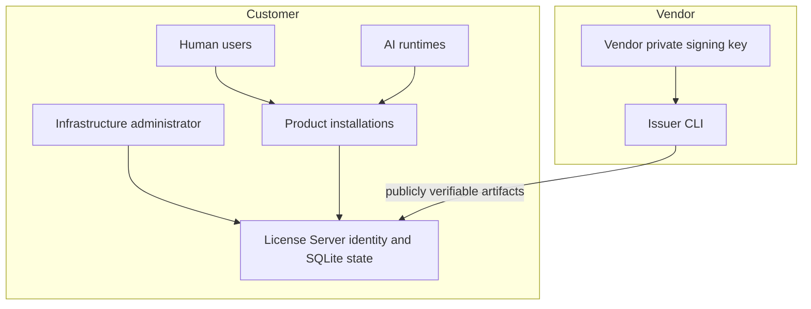

# Trust Model

The vendor private key never leaves the vendor domain. Customer runtime artifacts receive only the vendor public key. The License Server has a distinct local Ed25519 identity used for cached certificates. Each product installation has its own key pair and signs protected requests. Customer root administrators remain powerful: software controls can detect normal copying and state inconsistency but cannot defeat deliberate binary modification, full-machine snapshotting, or extraction of software-held keys.
