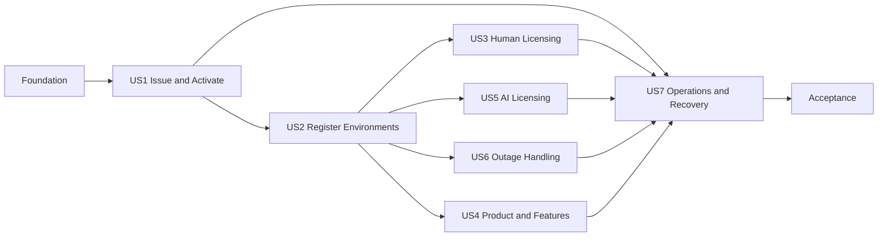

# Tasks: Central Offline License Server

**Input**: Design documents from `specs/001-central-offline-license-server/`
**Prerequisites**: `plan.md`, `spec.md`, `research.md`, `data-model.md`, `contracts/`, `quickstart.md`

**Tests**: Mandatory. Security, transactional boundary, outage, persistence, and acceptance tests are first-class deliverables.

**Organization**: Tasks are grouped by user story so each story can be implemented and verified as an independent increment. The implementation uses a dedicated embedded SQLite database and local Java processes. Cluster packaging and external database services are outside this POC.

## Format: `[ID] [P?] [Story] Description`

- **[P]**: Can run in parallel after its phase prerequisites are complete because it changes independent files
- **[US#]**: Maps the task to a user story in `spec.md`
- Every task names its exact target file or files

---

## Phase 1: Project Foundation

**Purpose**: Establish the Java 21 Maven reactor, module boundaries, dependency management, local runtime layout, and repeatable build.

- [X] T001 Create the Java 21 Maven reactor and module list in `offline-license-platform/pom.xml`
- [X] T002 [P] Create model and crypto module descriptors in `offline-license-platform/license-model/pom.xml` and `offline-license-platform/license-crypto/pom.xml`
- [X] T003 [P] Create engine and storage module descriptors in `offline-license-platform/license-engine/pom.xml` and `offline-license-platform/license-storage/pom.xml`
- [X] T004 [P] Create server and client module descriptors in `offline-license-platform/license-server/pom.xml` and `offline-license-platform/license-client-java/pom.xml`
- [X] T005 [P] Create issuer CLI and testkit module descriptors in `offline-license-platform/license-issuer-cli/pom.xml` and `offline-license-platform/license-testkit/pom.xml`
- [X] T006 [P] Create sample module descriptors in `offline-license-platform/examples/pom.xml`, `offline-license-platform/examples/sample-product/pom.xml`, `offline-license-platform/examples/tomcat-example/pom.xml`, and `offline-license-platform/examples/kubernetes-example/pom.xml`
- [X] T007 Configure Spring Boot 4.x, Jackson, Flyway SQLite support, Xerial SQLite JDBC, Picocli, JUnit 5, AssertJ, and canonical JSON dependency versions in `offline-license-platform/pom.xml`
- [X] T008 Configure Maven Enforcer, compiler, Surefire, Failsafe, JaCoCo, and reproducible-archive settings in `offline-license-platform/pom.xml`
- [X] T009 [P] Add the local runtime directory exclusions and generated sample exclusions to `offline-license-platform/.gitignore`
- [X] T010 [P] Add a clean-build workflow and local build entry point in `.github/workflows/license-platform-build.yml` and `offline-license-platform/scripts/build-local.sh`

---

## Phase 2: Foundational Architecture

**Purpose**: Build the shared type system, cryptographic substrate, SQLite transaction boundary, test fixtures, and server response conventions that block every user story.

**Critical**: No user-story work starts until this phase passes.

- [X] T011 Resolve and record deterministic signing, reduced-capacity renewal, backup failure, and health-readiness semantics in `specs/001-central-offline-license-server/spec.md` and `specs/001-central-offline-license-server/checklists/security-entitlement-operations.md`
- [X] T012 [P] Implement immutable identifier and time-range value objects in `offline-license-platform/license-model/src/main/java/com/enterprise/licensing/model/CommonValueObjects.java`
- [X] T013 [P] Implement the complete stable reason-code catalog in `offline-license-platform/license-model/src/main/java/com/enterprise/licensing/model/LicenseReasonCode.java`
- [X] T014 [P] Implement typed decision, response metadata, and operation-type models in `offline-license-platform/license-model/src/main/java/com/enterprise/licensing/model/LicenseDecision.java`, `offline-license-platform/license-model/src/main/java/com/enterprise/licensing/model/LicenseOperation.java`, and `offline-license-platform/license-model/src/main/java/com/enterprise/licensing/model/DecisionMetadata.java`
- [X] T015 [P] Implement the versioned signed-envelope and encoded-key models in `offline-license-platform/license-model/src/main/java/com/enterprise/licensing/model/SignedEnvelope.java` and `offline-license-platform/license-model/src/main/java/com/enterprise/licensing/model/EncodedPublicKey.java`
- [X] T016 Define runtime verification APIs in `offline-license-platform/license-crypto/src/main/java/com/enterprise/licensing/crypto/runtime/SignatureVerifier.java` and vendor signing APIs in the separate `offline-license-platform/license-crypto-vendor/src/main/java/com/enterprise/licensing/crypto/vendor/PayloadSigner.java` artifact
- [X] T017 [P] Implement RFC 8785 canonical payload production in `offline-license-platform/license-crypto/src/main/java/com/enterprise/licensing/crypto/CanonicalJson.java` and verify canonical equivalence in `offline-license-platform/license-crypto/src/test/java/com/enterprise/licensing/crypto/CanonicalJsonTest.java`
- [X] T018 [P] Implement Ed25519 generation, PKCS#8/X.509 encoding, signing, verification, and SHA-256 public-key fingerprints in `offline-license-platform/license-crypto/src/main/java/com/enterprise/licensing/crypto/Ed25519Keys.java` and `offline-license-platform/license-crypto/src/test/java/com/enterprise/licensing/crypto/Ed25519KeysTest.java`
- [X] T019 Define storage transaction, clock, identifier, and integrity-check ports in `offline-license-platform/license-engine/src/main/java/com/enterprise/licensing/engine/ports/TransactionRunner.java`, `offline-license-platform/license-engine/src/main/java/com/enterprise/licensing/engine/ports/TimeSource.java`, `offline-license-platform/license-engine/src/main/java/com/enterprise/licensing/engine/ports/IdGenerator.java`, and `offline-license-platform/license-engine/src/main/java/com/enterprise/licensing/engine/ports/StateIntegrityPort.java`
- [X] T020 Create the complete initial relational schema, invariants, indexes, and audit-chain columns in `offline-license-platform/license-storage/src/main/resources/db/migration/V1__initial_license_server_schema.sql`
- [X] T021 Configure the SQLite data source, WAL mode, foreign keys, synchronous FULL, busy timeout, and Flyway startup in `offline-license-platform/license-storage/src/main/java/com/enterprise/licensing/storage/sqlite/SqliteStorageConfiguration.java`
- [X] T022 Implement short `BEGIN IMMEDIATE` write transactions with bounded busy retries in `offline-license-platform/license-storage/src/main/java/com/enterprise/licensing/storage/sqlite/SqliteImmediateTransactionRunner.java`
- [X] T023 [P] Implement deterministic clocks, IDs, key fixtures, signed-artifact builders, and temporary SQLite stores in `offline-license-platform/license-testkit/src/main/java/com/enterprise/licensing/testkit/MutableTimeSource.java`, `offline-license-platform/license-testkit/src/main/java/com/enterprise/licensing/testkit/LicenseFixtures.java`, and `offline-license-platform/license-testkit/src/main/java/com/enterprise/licensing/testkit/TemporarySqliteStore.java`
- [X] T024 [P] Implement barrier-driven final-slot race helpers in `offline-license-platform/license-testkit/src/main/java/com/enterprise/licensing/testkit/ConcurrentRaceHarness.java`
- [X] T025 Create the Spring Boot entry point and module wiring in `offline-license-platform/license-server/src/main/java/com/enterprise/licensing/server/LicenseServerApplication.java` and `offline-license-platform/license-server/src/main/java/com/enterprise/licensing/server/config/ModuleConfiguration.java`
- [X] T026 [P] Implement stable REST response and error envelopes in `offline-license-platform/license-server/src/main/java/com/enterprise/licensing/server/api/ApiResponse.java` and `offline-license-platform/license-server/src/main/java/com/enterprise/licensing/server/api/ApiExceptionHandler.java`
- [X] T027 [P] Add local server configuration with loopback binding, external data/identity paths, TLS properties, lease defaults, and cache defaults in `offline-license-platform/license-server/src/main/resources/application.yml` and `offline-license-platform/deployment/local/application-local.yml`

**Checkpoint**: The reactor builds, canonical crypto tests pass, an empty database migrates, and the server starts locally with no vendor private key.

---

## Phase 3: User Story 1 — Issue and Activate a Bound Customer License (Priority: P1) 🎯 MVP

**Goal**: Issue a signed versioned license, generate a persistent server identity, complete offline activation, reject tampering and wrong-server copies, and support same-identity renewal.

**Independent Test**: Generate a vendor key, issue the A Inc. license, start an unactivated server, export/sign/import activation, observe ACTIVE, reject a modified license and a certificate on a second identity, restart without identity change, and renew without regenerating identity.

### Tests for User Story 1

- [X] T028 [P] [US1] Add commercial-license JSON Schema and legacy-field compatibility contract tests in `offline-license-platform/license-model/src/test/java/com/enterprise/licensing/model/CommercialLicenseContractTest.java`
- [X] T029 [P] [US1] Add signed-envelope tamper, signature mutation, wrong-key, malformed payload, and unsupported-version tests in `offline-license-platform/license-crypto/src/test/java/com/enterprise/licensing/crypto/CommercialLicenseCryptoTest.java`
- [X] T030 [P] [US1] Add CLI contract tests for keygen, issue, inspect, and verify exit codes and structured output in `offline-license-platform/license-issuer-cli/src/test/java/com/enterprise/licensing/issuer/LicenseIssuerCliTest.java`
- [X] T031 [P] [US1] Add first-start, restrictive-permission, restart, and missing-key identity tests in `offline-license-platform/license-storage/src/test/java/com/enterprise/licensing/storage/SoftwareIdentityProviderTest.java`
- [X] T032 [P] [US1] Add activation request, modified certificate, wrong server, wrong customer, nonce, and copy-to-second-server integration tests in `offline-license-platform/license-server/src/test/java/com/enterprise/licensing/server/activation/ActivationIntegrationTest.java`
- [X] T033 [P] [US1] Add same-identity renewal and reduced-capacity renewal behavior tests in `offline-license-platform/license-server/src/test/java/com/enterprise/licensing/server/activation/LicenseRenewalIntegrationTest.java`

### Implementation for User Story 1

- [X] T034 [P] [US1] Implement strongly typed commercial license, subscription, activation policy, environment, user, product, feature, AI, and meter entitlement records in `offline-license-platform/license-model/src/main/java/com/enterprise/licensing/model/CommercialLicense.java`, `offline-license-platform/license-model/src/main/java/com/enterprise/licensing/model/SubscriptionEntitlement.java`, `offline-license-platform/license-model/src/main/java/com/enterprise/licensing/model/ActivationPolicy.java`, `offline-license-platform/license-model/src/main/java/com/enterprise/licensing/model/EnvironmentEntitlement.java`, `offline-license-platform/license-model/src/main/java/com/enterprise/licensing/model/UserEntitlement.java`, `offline-license-platform/license-model/src/main/java/com/enterprise/licensing/model/ProductEntitlement.java`, and `offline-license-platform/license-model/src/main/java/com/enterprise/licensing/model/AIEntitlement.java`
- [X] T035 [P] [US1] Implement current-license JSON parsing and explicit legacy business-field migration in `offline-license-platform/license-model/src/main/java/com/enterprise/licensing/model/CommercialLicenseJsonCodec.java` and `offline-license-platform/license-model/src/main/java/com/enterprise/licensing/model/LegacyLicenseMapper.java`
- [X] T036 [US1] Implement commercial license signing and runtime verification against canonical payload bytes in `offline-license-platform/license-crypto/src/main/java/com/enterprise/licensing/crypto/vendor/CommercialLicenseSigner.java` and `offline-license-platform/license-crypto/src/main/java/com/enterprise/licensing/crypto/runtime/CommercialLicenseVerifier.java`
- [X] T037 [US1] Implement vendor CLI commands `keygen`, `issue-license`, `inspect-license`, and `verify-license` in `offline-license-platform/license-issuer-cli/src/main/java/com/enterprise/licensing/issuer/LicenseIssuerCli.java` and `offline-license-platform/license-issuer-cli/src/main/java/com/enterprise/licensing/issuer/commands/LicenseCommands.java`
- [X] T038 [P] [US1] Add A Inc. unsigned input and generation command in `offline-license-platform/samples/licenses/a-inc-license-input.json` and `offline-license-platform/scripts/generate-a-inc-license.sh`
- [X] T039 [US1] Define the replaceable identity provider boundary and software identity material in `offline-license-platform/license-engine/src/main/java/com/enterprise/licensing/engine/identity/IdentityProvider.java` and `offline-license-platform/license-model/src/main/java/com/enterprise/licensing/model/LicenseServerIdentity.java`
- [X] T040 [US1] Implement atomic first-start identity generation, restrictive file permissions, load, and fingerprint verification in `offline-license-platform/license-storage/src/main/java/com/enterprise/licensing/storage/identity/SoftwareIdentityProvider.java`
- [X] T041 [US1] Implement identity orchestration without private-key exposure in `offline-license-platform/license-engine/src/main/java/com/enterprise/licensing/engine/identity/LicenseServerIdentityService.java`
- [X] T042 [P] [US1] Implement activation request and certificate domain records in `offline-license-platform/license-model/src/main/java/com/enterprise/licensing/model/ActivationRequest.java` and `offline-license-platform/license-model/src/main/java/com/enterprise/licensing/model/ActivationCertificate.java`
- [X] T043 [US1] Implement activation request generation with nonce, license/customer binding, public key, fingerprint, timestamp, and optional evidence in `offline-license-platform/license-engine/src/main/java/com/enterprise/licensing/engine/activation/ActivationRequestService.java`
- [X] T044 [US1] Implement vendor activation signing and runtime verification in `offline-license-platform/license-crypto/src/main/java/com/enterprise/licensing/crypto/vendor/ActivationSigner.java` and `offline-license-platform/license-crypto/src/main/java/com/enterprise/licensing/crypto/runtime/ActivationVerifier.java`
- [X] T045 [US1] Implement encrypted-at-rest license import compatibility, commercial-license persistence, activation import, binding checks, and renewal replacement in `offline-license-platform/license-engine/src/main/java/com/enterprise/licensing/engine/activation/ActivationService.java` and `offline-license-platform/license-storage/src/main/java/com/enterprise/licensing/storage/repository/SqliteLicenseRepository.java`
- [X] T046 [US1] Implement activation request/import and initial status endpoints in `offline-license-platform/license-server/src/main/java/com/enterprise/licensing/server/api/admin/ActivationController.java` and `offline-license-platform/license-server/src/main/java/com/enterprise/licensing/server/api/admin/StatusController.java`
- [X] T047 [US1] Add `inspect-activation-request`, `activate-license-server`, and `inspect-activation-certificate` commands in `offline-license-platform/license-issuer-cli/src/main/java/com/enterprise/licensing/issuer/commands/ActivationCommands.java`

**Checkpoint**: User Story 1 passes without any product registration, user, or AI functionality present.

---

## Phase 4: User Story 2 — Register and Govern Logical Environments (Priority: P1)

**Goal**: Register stable authenticated Tomcat or Kubernetes logical installations, enforce environment limits globally, support lifecycle transitions, and coordinate PROD/DR activity.

**Independent Test**: Register PROD and UAT, reject a concurrent second PROD, reconnect the same signed identity without new consumption, simulate replica scale and restarts as one instance, decommission explicitly, reuse the released slot, and atomically promote/fail back DR.

### Tests for User Story 2

- [X] T048 [P] [US2] Add signed-request attribution, invalid signature, replay, stale timestamp, and key-mismatch tests in `offline-license-platform/license-server/src/test/java/com/enterprise/licensing/server/security/InstanceRequestAuthenticationTest.java`
- [X] T049 [P] [US2] Add logical registration, reconnect, Tomcat restart, replica scaling, namespace recreation, decommission, and entitlement reuse tests in `offline-license-platform/license-server/src/test/java/com/enterprise/licensing/server/instance/InstanceLifecycleIntegrationTest.java`
- [X] T050 [P] [US2] Add barrier-driven final PROD, UAT, QA, DEVELOPMENT, and OTHER registration race tests in `offline-license-platform/license-storage/src/test/java/com/enterprise/licensing/storage/EnvironmentRegistrationRaceTest.java`
- [X] T051 [P] [US2] Add ACTIVE/STANDBY, promotion, demotion, forced failover, failback, and single production-class activity race tests in `offline-license-platform/license-storage/src/test/java/com/enterprise/licensing/storage/DisasterRecoveryRaceTest.java`

### Implementation for User Story 2

- [X] T052 [P] [US2] Implement product instance, deployment type, environment type, lifecycle state, and transition records in `offline-license-platform/license-model/src/main/java/com/enterprise/licensing/model/RegisteredProductInstance.java`, `offline-license-platform/license-model/src/main/java/com/enterprise/licensing/model/DeploymentType.java`, `offline-license-platform/license-model/src/main/java/com/enterprise/licensing/model/EnvironmentType.java`, and `offline-license-platform/license-model/src/main/java/com/enterprise/licensing/model/InstanceState.java`
- [X] T053 [P] [US2] Implement installation-generated product identity creation and secure persistence in `offline-license-platform/license-client-java/src/main/java/com/enterprise/licensing/client/identity/ProductInstanceIdentityStore.java`
- [X] T054 [US2] Implement administrator-authorized bootstrap registration and registered public-key persistence in `offline-license-platform/license-engine/src/main/java/com/enterprise/licensing/engine/instance/InstanceRegistrationService.java` and `offline-license-platform/license-storage/src/main/java/com/enterprise/licensing/storage/repository/SqliteProductInstanceRepository.java`
- [X] T055 [US2] Implement request canonicalization, body digesting, nonce creation, timestamping, and Ed25519 signing in `offline-license-platform/license-client-java/src/main/java/com/enterprise/licensing/client/security/SignedInstanceRequestFactory.java`
- [X] T056 [US2] Implement registered-instance signature verification, nonce persistence, replay rejection, and clock-window checks in `offline-license-platform/license-server/src/main/java/com/enterprise/licensing/server/security/InstanceRequestAuthenticationFilter.java` and `offline-license-platform/license-storage/src/main/java/com/enterprise/licensing/storage/repository/SqliteRequestNonceRepository.java`
- [X] T057 [US2] Implement transactional environment capacity allocation and idempotent identity reconnection in `offline-license-platform/license-engine/src/main/java/com/enterprise/licensing/engine/environment/EnvironmentAllocationService.java`
- [X] T058 [US2] Implement authorized REGISTERED, STANDBY, ACTIVE, and DECOMMISSIONED transitions with drain/force modes in `offline-license-platform/license-engine/src/main/java/com/enterprise/licensing/engine/environment/EnvironmentLifecycleService.java`
- [X] T059 [US2] Implement atomic PROD/DR promotion, demotion, failover, and failback under the production-class limit in `offline-license-platform/license-engine/src/main/java/com/enterprise/licensing/engine/environment/DisasterRecoveryService.java`
- [X] T060 [US2] Implement instance registration, listing, decommission, activation, and standby endpoints in `offline-license-platform/license-server/src/main/java/com/enterprise/licensing/server/api/admin/InstanceAdminController.java`
- [X] T061 [US2] Implement runtime registration and authenticated reconnect endpoints in `offline-license-platform/license-server/src/main/java/com/enterprise/licensing/server/api/runtime/InstanceRuntimeController.java`
- [X] T062 [P] [US2] Implement shared Kubernetes logical identity loading across replicas in `offline-license-platform/examples/kubernetes-example/src/main/java/com/enterprise/licensing/example/kubernetes/SharedInstallationIdentity.java`
- [X] T063 [P] [US2] Implement stable Tomcat installation identity loading across restarts in `offline-license-platform/examples/tomcat-example/src/main/java/com/enterprise/licensing/example/tomcat/TomcatInstallationIdentity.java`
- [X] T064 [US2] Add a local multi-replica simulator proving one logical registration across replica restarts and scaling in `offline-license-platform/examples/kubernetes-example/src/test/java/com/enterprise/licensing/example/kubernetes/LogicalReplicaIdentityIntegrationTest.java`
- [X] T065 [US2] Document namespace deletion/recreation recovery, identity backup requirements, registration lifecycle, decommission, and DR transitions in `offline-license-platform/docs/environment-registration.md` and `offline-license-platform/docs/disaster-recovery.md`

**Checkpoint**: User Story 2 passes with one authoritative environment pool and cryptographically attributable instances.

---

## Phase 5: User Story 3 — Enforce Shared Human Licensing (Priority: P1)

**Goal**: Enforce global named users, categories, product capacity, and concurrent-user leases across all environments with safe crash expiry and restart behavior.

**Independent Test**: Allocate named users to the global and category boundaries, enforce reassignment cooldown, fill 20 concurrent slots across environments, prove exactly one winner for the last slot, expire a crashed session, restart the server, and acquire replacement capacity.

### Tests for User Story 3

- [X] T066 [P] [US3] Add named-user global/category/product limit, release, cooldown, and audited-override tests in `offline-license-platform/license-storage/src/test/java/com/enterprise/licensing/storage/NamedUserAssignmentIntegrationTest.java`
- [X] T067 [P] [US3] Add barrier-driven final named-user assignment race tests in `offline-license-platform/license-storage/src/test/java/com/enterprise/licensing/storage/NamedUserAssignmentRaceTest.java`
- [X] T068 [P] [US3] Add cross-environment user lease acquisition, heartbeat, browser crash, expiry, release, and restart tests in `offline-license-platform/license-storage/src/test/java/com/enterprise/licensing/storage/ConcurrentUserLeaseIntegrationTest.java`
- [X] T069 [P] [US3] Add barrier-driven final concurrent-user slot race tests in `offline-license-platform/license-storage/src/test/java/com/enterprise/licensing/storage/ConcurrentUserLeaseRaceTest.java`

### Implementation for User Story 3

- [X] T070 [P] [US3] Implement named assignment, user category, concurrent lease, and lease-status records in `offline-license-platform/license-model/src/main/java/com/enterprise/licensing/model/NamedUserAssignment.java`, `offline-license-platform/license-model/src/main/java/com/enterprise/licensing/model/UserCategory.java`, and `offline-license-platform/license-model/src/main/java/com/enterprise/licensing/model/ConcurrentUserLease.java`
- [X] T071 [US3] Implement named-user repository queries and atomic global/category/product capacity writes in `offline-license-platform/license-storage/src/main/java/com/enterprise/licensing/storage/repository/SqliteNamedUserRepository.java`
- [X] T072 [US3] Implement assignment, explicit release, 30-day reassignment cooldown, audited override, and utilization in `offline-license-platform/license-engine/src/main/java/com/enterprise/licensing/engine/user/NamedUserService.java`
- [X] T073 [US3] Implement lease repository queries that count only unexpired absolute expiries and atomically reserve capacity in `offline-license-platform/license-storage/src/main/java/com/enterprise/licensing/storage/repository/SqliteUserLeaseRepository.java`
- [X] T074 [US3] Implement 5-minute concurrent-user leases, 1-minute heartbeat expectation, idempotent heartbeat/release, and global utilization in `offline-license-platform/license-engine/src/main/java/com/enterprise/licensing/engine/user/ConcurrentUserLeaseService.java`
- [X] T075 [US3] Implement named-user and concurrent-lease administrative/runtime endpoints in `offline-license-platform/license-server/src/main/java/com/enterprise/licensing/server/api/admin/NamedUserController.java` and `offline-license-platform/license-server/src/main/java/com/enterprise/licensing/server/api/runtime/UserLeaseController.java`
- [X] T076 [US3] Add named-user and user-lease operations to the typed client facade in `offline-license-platform/license-client-java/src/main/java/com/enterprise/licensing/client/LicenseClient.java`
- [X] T077 [US3] Implement resilient heartbeat scheduling and local lease-expiry enforcement in `offline-license-platform/license-client-java/src/main/java/com/enterprise/licensing/client/lease/UserLeaseManager.java`
- [X] T078 [US3] Add API contract tests for stable human-license reason codes and response shapes in `offline-license-platform/license-server/src/test/java/com/enterprise/licensing/server/api/UserLicensingApiContractTest.java`
- [X] T079 [US3] Document account classification, shared pools, reassignment, lease timing, crash recovery, and restart semantics in `offline-license-platform/docs/user-licensing.md`

**Checkpoint**: User Story 3 passes with no increment/decrement-only accounting and no environment-specific multiplication.

---

## Phase 6: User Story 5 — License AI Agents Independently (Priority: P1)

**Goal**: Enforce AI enablement, agent registration, concurrent execution leases, configurable AEU policy, and monthly customer-wide transactional metering independently from human seats.

**Independent Test**: Disable AI and observe denial; register up to the global limit; race for the final registration and execution slots; expire a crashed execution; consume the final AEU atomically across environments; reject overflow; and start the next UTC month at zero without rollover.

### Tests for User Story 5

- [X] T080 [P] [US5] Add AI-disabled, registration lifecycle, global limit, and final registration-slot race tests in `offline-license-platform/license-storage/src/test/java/com/enterprise/licensing/storage/AgentRegistrationRaceTest.java`
- [X] T081 [P] [US5] Add execution acquire, heartbeat, crash expiry, release, restart, and final-slot race tests in `offline-license-platform/license-storage/src/test/java/com/enterprise/licensing/storage/AgentExecutionLeaseRaceTest.java`
- [X] T082 [P] [US5] Add monthly UTC boundary, no-rollover, idempotency, exact-limit, overflow, and concurrent final-AEU tests in `offline-license-platform/license-storage/src/test/java/com/enterprise/licensing/storage/MeteringRaceTest.java`
- [X] T083 [P] [US5] Add AEU action-weight configuration and unknown-action tests in `offline-license-platform/license-engine/src/test/java/com/enterprise/licensing/engine/ai/ConfiguredAeuPolicyTest.java`

### Implementation for User Story 5

- [X] T084 [P] [US5] Implement registered agent, agent execution lease, meter period, usage counter, consumption, and decision models in `offline-license-platform/license-model/src/main/java/com/enterprise/licensing/model/RegisteredAgent.java`, `offline-license-platform/license-model/src/main/java/com/enterprise/licensing/model/AgentExecutionLease.java`, `offline-license-platform/license-model/src/main/java/com/enterprise/licensing/model/MeterPeriod.java`, `offline-license-platform/license-model/src/main/java/com/enterprise/licensing/model/UsageCounter.java`, and `offline-license-platform/license-model/src/main/java/com/enterprise/licensing/model/UsageConsumption.java`
- [X] T085 [US5] Implement atomic customer-wide agent registration persistence in `offline-license-platform/license-storage/src/main/java/com/enterprise/licensing/storage/repository/SqliteAgentRepository.java`
- [X] T086 [US5] Implement AI entitlement checks, registration, removal, and utilization in `offline-license-platform/license-engine/src/main/java/com/enterprise/licensing/engine/ai/AgentRegistryService.java`
- [X] T087 [US5] Implement expiry-aware atomic agent execution lease persistence in `offline-license-platform/license-storage/src/main/java/com/enterprise/licensing/storage/repository/SqliteAgentLeaseRepository.java`
- [X] T088 [US5] Implement 5-minute execution leases, 1-minute heartbeat expectation, idempotent release, and global concurrency decisions in `offline-license-platform/license-engine/src/main/java/com/enterprise/licensing/engine/ai/AgentLeaseService.java`
- [X] T089 [US5] Implement atomic idempotent meter consumption keyed by meter/window/customer and request ID in `offline-license-platform/license-storage/src/main/java/com/enterprise/licensing/storage/repository/SqliteMeterRepository.java`
- [X] T090 [US5] Implement deterministic UTC monthly windows, generic meters, zero rollover, and exact-boundary decisions in `offline-license-platform/license-engine/src/main/java/com/enterprise/licensing/engine/metering/MeteringService.java`
- [X] T091 [US5] Define the AEU policy port and configurable action weights in `offline-license-platform/license-engine/src/main/java/com/enterprise/licensing/engine/ai/AeuPolicy.java` and `offline-license-platform/license-engine/src/main/java/com/enterprise/licensing/engine/ai/ConfiguredAeuPolicy.java`
- [X] T092 [US5] Implement agent registry, execution lease, and usage endpoints in `offline-license-platform/license-server/src/main/java/com/enterprise/licensing/server/api/runtime/AgentController.java` and `offline-license-platform/license-server/src/main/java/com/enterprise/licensing/server/api/runtime/UsageController.java`
- [X] T093 [US5] Add agent execution and usage operations to the typed client facade in `offline-license-platform/license-client-java/src/main/java/com/enterprise/licensing/client/LicenseClient.java`
- [X] T094 [US5] Implement agent heartbeat scheduling and local expiry enforcement in `offline-license-platform/license-client-java/src/main/java/com/enterprise/licensing/client/lease/AgentLeaseManager.java`
- [X] T095 [US5] Add stable AI and metering API contract tests in `offline-license-platform/license-server/src/test/java/com/enterprise/licensing/server/api/AiLicensingApiContractTest.java`
- [X] T096 [US5] Document separate human/AI policy, agent lifecycle, AEU weights, global aggregation, monthly UTC windows, and no rollover in `offline-license-platform/docs/ai-licensing.md`

**Checkpoint**: User Story 5 passes independently of human-user entitlements.

---

## Phase 7: User Story 6 — Continue Safely During a Server Outage (Priority: P1)

**Goal**: Issue instance-bound short-lived cached entitlements and apply explicit operation-specific outage behavior without losing global accounting correctness.

**Independent Test**: Issue a cache certificate, stop the local server process, allow product/feature checks, deny new central allocations and metered AI work, allow only an already-valid lease until expiry, reject expired/tampered/wrong-instance cache, restart, and recover automatically.

### Tests for User Story 6

- [X] T097 [P] [US6] Add cached-certificate signature, instance fingerprint, server identity, license, expiry, and tamper tests in `offline-license-platform/license-crypto/src/test/java/com/enterprise/licensing/crypto/CachedEntitlementCryptoTest.java`
- [X] T098 [P] [US6] Add local-process outage, 24-hour cap, license/grace cap, central-only denial, valid-lease behavior, expiry, and reconnect tests in `offline-license-platform/license-client-java/src/test/java/com/enterprise/licensing/client/OutageRecoveryIntegrationTest.java`
- [X] T099 [P] [US6] Add operation-by-operation fail-open/fail-closed policy tests in `offline-license-platform/license-client-java/src/test/java/com/enterprise/licensing/client/LicenseAvailabilityPolicyTest.java`

### Implementation for User Story 6

- [X] T100 [P] [US6] Implement cached entitlement certificate, offline operation policy, and cached decision models in `offline-license-platform/license-model/src/main/java/com/enterprise/licensing/model/CachedEntitlementCertificate.java`, `offline-license-platform/license-model/src/main/java/com/enterprise/licensing/model/OfflineOperationPolicy.java`, and `offline-license-platform/license-model/src/main/java/com/enterprise/licensing/model/CachedLicenseDecision.java`
- [X] T101 [US6] Implement server signing and client runtime verification of canonical cached certificates in `offline-license-platform/license-crypto/src/main/java/com/enterprise/licensing/crypto/runtime/CachedEntitlementSigner.java` and `offline-license-platform/license-crypto/src/main/java/com/enterprise/licensing/crypto/runtime/CachedEntitlementVerifier.java`
- [X] T102 [US6] Implement issuance bounded to 24 hours, subscription/grace end, registered instance, and instance-key fingerprint in `offline-license-platform/license-engine/src/main/java/com/enterprise/licensing/engine/cache/CachedEntitlementService.java`
- [X] T103 [US6] Persist certificate issuance metadata without private keys in `offline-license-platform/license-storage/src/main/java/com/enterprise/licensing/storage/repository/SqliteCachedEntitlementRepository.java`
- [X] T104 [US6] Implement cache issuance endpoint with authenticated instance attribution in `offline-license-platform/license-server/src/main/java/com/enterprise/licensing/server/api/runtime/CachedEntitlementController.java`
- [X] T105 [US6] Implement local encrypted-file cache persistence and secure server-public-key pinning in `offline-license-platform/license-client-java/src/main/java/com/enterprise/licensing/client/cache/FileCachedEntitlementStore.java`
- [X] T106 [US6] Implement operation-specific availability decisions for product, feature, login, assignment, registration, agent, execution, and usage operations in `offline-license-platform/license-client-java/src/main/java/com/enterprise/licensing/client/availability/LicenseAvailabilityPolicy.java`
- [X] T107 [US6] Implement connectivity failure classification, local certificate fallback, reconnect refresh, and stable reason mapping in `offline-license-platform/license-client-java/src/main/java/com/enterprise/licensing/client/DefaultLicenseClient.java`
- [X] T108 [US6] Document cached certificate trust, maximum lifetime, zero offline AEU allowance, lease behavior, and the fail-open/fail-closed matrix in `offline-license-platform/docs/cached-entitlements.md` and `offline-license-platform/docs/failure-semantics.md`

**Checkpoint**: User Story 6 passes with the server process unavailable and no external connectivity.

---

## Phase 8: User Story 4 — Check Products and Features (Priority: P2)

**Goal**: Expose stable server-authoritative product/feature decisions and legacy Validator sub-product compatibility without leaking commercial-license JSON into product code.

**Independent Test**: Check enabled and disabled products, enforce per-product user capacity, allow Validator TABLEAU/ORACLE_ANALYTICS/COGNOS, reject an unlicensed feature with the required reason, and repeat eligible checks from cache.

### Tests for User Story 4

- [X] T109 [P] [US4] Add product enablement, per-product capacity, unknown product, and instance-registration tests in `offline-license-platform/license-engine/src/test/java/com/enterprise/licensing/engine/entitlement/ProductEntitlementServiceTest.java`
- [X] T110 [P] [US4] Add Validator feature mapping, unknown feature, disabled product, and cache-equivalence tests in `offline-license-platform/license-engine/src/test/java/com/enterprise/licensing/engine/entitlement/FeatureEntitlementServiceTest.java`
- [X] T111 [P] [US4] Add stable product/feature response contract tests in `offline-license-platform/license-server/src/test/java/com/enterprise/licensing/server/api/ProductEntitlementApiContractTest.java`

### Implementation for User Story 4

- [X] T112 [P] [US4] Implement normalized product ID, feature ID, and entitlement decision records in `offline-license-platform/license-model/src/main/java/com/enterprise/licensing/model/ProductId.java`, `offline-license-platform/license-model/src/main/java/com/enterprise/licensing/model/FeatureId.java`, and `offline-license-platform/license-model/src/main/java/com/enterprise/licensing/model/EntitlementDecision.java`
- [X] T113 [US4] Implement centralized product, feature, instance, license-state, and per-product capacity evaluation in `offline-license-platform/license-engine/src/main/java/com/enterprise/licensing/engine/entitlement/EntitlementService.java`
- [X] T114 [US4] Implement explicit legacy Validator sub-product normalization in `offline-license-platform/license-engine/src/main/java/com/enterprise/licensing/engine/entitlement/LegacyFeatureCatalog.java`
- [X] T115 [US4] Implement authenticated product and feature runtime endpoints in `offline-license-platform/license-server/src/main/java/com/enterprise/licensing/server/api/runtime/EntitlementController.java`
- [X] T116 [US4] Add `product`, `feature`, `requireProduct`, and `requireFeature` methods to `offline-license-platform/license-client-java/src/main/java/com/enterprise/licensing/client/LicenseClient.java`
- [X] T117 [US4] Integrate central and cached entitlement resolution in `offline-license-platform/license-client-java/src/main/java/com/enterprise/licensing/client/DefaultLicenseClient.java`
- [X] T118 [US4] Document stable entitlement APIs, product capacities, and Validator feature compatibility in `offline-license-platform/docs/product-entitlements.md`

**Checkpoint**: User Story 4 passes without product code parsing or understanding the signed license document.

---

## Phase 9: User Story 7 — Operate, Diagnose, and Recover the License Service (Priority: P2)

**Goal**: Provide trusted-time validation, tamper-evident audit, actionable status/health, safe same-host backup/restore, recovery-required handling, diagnostics, and local administration.

**Independent Test**: Restart with all state preserved; observe status/utilization/audit; detect clock rollback and corrupt/stale restored state; take and restore a same-host backup without exporting the private key; require reactivation after full state deletion or hardware migration; and verify health semantics in unactivated, active, degraded, and recovery-required states.

### Tests for User Story 7

- [X] T119 [P] [US7] Add expiry, restricted 7-day grace, not-yet-valid, renewal, and explicit reason-code tests in `offline-license-platform/license-engine/src/test/java/com/enterprise/licensing/engine/validation/LicenseValidationServiceTest.java`
- [X] T120 [P] [US7] Add highest-time persistence, 5-minute rollback tolerance, separate checkpoint mismatch, and root-admin limitation tests in `offline-license-platform/license-storage/src/test/java/com/enterprise/licensing/storage/TrustedTimeIntegrationTest.java`
- [X] T121 [P] [US7] Add audit hash-chain verification, sensitive-field filtering, paging, and corruption tests in `offline-license-platform/license-storage/src/test/java/com/enterprise/licensing/storage/AuditIntegrityIntegrationTest.java`
- [X] T122 [P] [US7] Add restart persistence, stale backup RECOVERY_REQUIRED, same-host restore, full deletion, and migration tests in `offline-license-platform/license-server/src/test/java/com/enterprise/licensing/server/operations/RecoveryIntegrationTest.java`
- [X] T123 [P] [US7] Add status, utilization, diagnostics, liveness, and readiness state contract tests in `offline-license-platform/license-server/src/test/java/com/enterprise/licensing/server/api/OperationsApiContractTest.java`

### Implementation for User Story 7

- [X] T124 [US7] Implement separated schema, signature, activation, subscription, grace, entitlement, and state-integrity validation stages in `offline-license-platform/license-engine/src/main/java/com/enterprise/licensing/engine/validation/LicenseValidationService.java`
- [X] T125 [US7] Implement persistent highest accepted time, 5-minute rollback tolerance, explicit rollback decisions, and checkpoint comparison in `offline-license-platform/license-engine/src/main/java/com/enterprise/licensing/engine/time/TrustedTimeService.java`, `offline-license-platform/license-storage/src/main/java/com/enterprise/licensing/storage/repository/SqliteTrustedTimeRepository.java`, and `offline-license-platform/license-storage/src/main/java/com/enterprise/licensing/storage/integrity/FileTrustedTimeCheckpoint.java`
- [X] T126 [P] [US7] Implement audit event domain objects and redaction rules in `offline-license-platform/license-model/src/main/java/com/enterprise/licensing/model/AuditEvent.java` and `offline-license-platform/license-engine/src/main/java/com/enterprise/licensing/engine/audit/AuditRedactor.java`
- [X] T127 [US7] Implement append-only audit persistence with chained hashes and verification in `offline-license-platform/license-storage/src/main/java/com/enterprise/licensing/storage/repository/SqliteAuditRepository.java`
- [X] T128 [US7] Implement centralized audited decision recording while suppressing routine successful heartbeats by default in `offline-license-platform/license-engine/src/main/java/com/enterprise/licensing/engine/audit/AuditService.java`
- [X] T129 [US7] Implement status, entitlement summary, environment/user/agent/meter utilization, grace warnings, clock warnings, and recovery state aggregation in `offline-license-platform/license-engine/src/main/java/com/enterprise/licensing/engine/status/LicenseStatusService.java`
- [X] T130 [US7] Implement status, entitlements, utilization, audit, and support-diagnostics endpoints in `offline-license-platform/license-server/src/main/java/com/enterprise/licensing/server/api/admin/OperationsController.java`
- [X] T131 [US7] Implement liveness independent of activation and readiness based on identity, migrated storage, and nonfatal licensing state in `offline-license-platform/license-server/src/main/java/com/enterprise/licensing/server/health/LicenseServerHealthIndicator.java`
- [X] T132 [US7] Implement atomic online SQLite backup coordination, integrity verification, and same-host restore validation in `offline-license-platform/license-storage/src/main/java/com/enterprise/licensing/storage/operations/SqliteBackupService.java`
- [X] T133 [US7] Implement startup detection for missing identity, missing state, stale restored state, corrupt state, and RECOVERY_REQUIRED transitions in `offline-license-platform/license-engine/src/main/java/com/enterprise/licensing/engine/recovery/RecoveryService.java`
- [X] T134 [P] [US7] Add customer admin commands for status, activation request/import, license import, instances, usage, audit, backup, and restore in `offline-license-platform/scripts/customer-cli.sh`, `offline-license-platform/scripts/backup-license-server.sh`, and `offline-license-platform/scripts/restore-license-server.sh`
- [X] T135 [US7] Document software identity limits, same-host backup/restore, new-hardware migration/reactivation, complete VM copy residual risk, persistent deletion, and future identity/storage-provider seams in `offline-license-platform/docs/license-server-identity.md` and `offline-license-platform/docs/operations.md`
- [X] T136 [US7] Document audit reason codes, diagnostics, health states, clock rollback, expiry, grace, renewal, corrupt state, and stale restore behavior in `offline-license-platform/docs/audit-and-diagnostics.md` and `offline-license-platform/docs/subscription-lifecycle.md`

**Checkpoint**: User Story 7 passes with deterministic recovery states and no claim of perfect clone prevention.

---

## Phase 10: Polish, Samples, Security Suite, and POC Acceptance

**Purpose**: Complete local samples, threat documentation, end-to-end proof, artifact isolation, and full requirement traceability.

- [X] T137 [P] Implement the sample product startup, status, feature check, user lease, and AI execution flow in `offline-license-platform/examples/sample-product/src/main/java/com/enterprise/licensing/example/product/SampleProductApplication.java`
- [X] T138 [P] Implement the Tomcat integration listener, stable identity bootstrap, lease heartbeat, and shutdown release example in `offline-license-platform/examples/tomcat-example/src/main/java/com/enterprise/licensing/example/tomcat/LicenseLifecycleListener.java`
- [X] T139 [P] Implement the three-replica local Kubernetes behavior simulator and shared client facade in `offline-license-platform/examples/kubernetes-example/src/main/java/com/enterprise/licensing/example/kubernetes/KubernetesReplicaSimulator.java`
- [X] T140 Create local start/stop scripts for the server and sample product in `offline-license-platform/scripts/run-license-server-local.sh`, `offline-license-platform/scripts/run-sample-product-local.sh`, and `offline-license-platform/scripts/stop-local-processes.sh`
- [X] T141 [P] Add process-level API lifecycle tests covering activation, environments, users, products, AI, audit, restart, and recovery in `offline-license-platform/license-server/src/test/java/com/enterprise/licensing/server/e2e/LicenseLifecycleProcessTest.java`
- [X] T142 [P] Add the consolidated security suite for artifact tampering, schema attacks, activation mismatch, identity mismatch, nonce replay, corrupt state, and clock rollback in `offline-license-platform/license-testkit/src/test/java/com/enterprise/licensing/security/LicensePlatformSecuritySuite.java`
- [X] T143 [P] Add runtime dependency-boundary tests proving server/client artifacts cannot depend on vendor signing packages in `offline-license-platform/license-testkit/src/test/java/com/enterprise/licensing/security/VendorSigningBoundaryTest.java`
- [X] T144 [P] Add packaged-artifact scanning for private keys, seed material, default secrets, and forbidden signing classes in `offline-license-platform/license-testkit/src/test/java/com/enterprise/licensing/security/RuntimeArtifactSecretScanTest.java`
- [X] T145 [P] Add a runtime network-policy test proving normal customer flows contact only configured internal endpoints and never require outbound Internet access in `offline-license-platform/license-testkit/src/test/java/com/enterprise/licensing/security/OfflineNetworkBehaviorTest.java`
- [X] T146 Add the automated 40-step local commercial-license acceptance demonstration in `offline-license-platform/scripts/poc-demo-local.sh` and assertions in `offline-license-platform/license-testkit/src/test/java/com/enterprise/licensing/e2e/PocAcceptanceTest.java`
- [X] T147 [P] Document system context, components, transaction boundaries, and extension seams with Mermaid diagrams in `offline-license-platform/docs/architecture.md`
- [X] T148 [P] Document vendor, server, product, user, and infrastructure trust domains with Mermaid diagrams in `offline-license-platform/docs/trust-model.md`
- [X] T149 [P] Document assets, attackers, controls, residual root/admin and VM-copy risks, and deferred hardware identity in `offline-license-platform/docs/threat-model.md`
- [X] T150 [P] Document versioned license schema, canonical signed envelope, key encodings, fingerprints, and compatibility in `offline-license-platform/docs/license-format.md` and `offline-license-platform/docs/license-signing.md`
- [X] T151 [P] Document the export/sign/import activation ceremony and renewal behavior in `offline-license-platform/docs/offline-activation.md`
- [X] T152 [P] Document Java client configuration, signed-request authentication, internal HTTPS, certificate pinning, and future mTLS in `offline-license-platform/docs/client-integration.md`
- [X] T153 [P] Document local Java installation, configuration, data directories, TLS setup, backup, service-manager examples, and air-gap preparation in `offline-license-platform/docs/local-deployment.md`
- [X] T154 [P] Document Tomcat lifecycle integration and identity persistence in `offline-license-platform/docs/tomcat.md`
- [X] T155 [P] Document logical replica identity, shared persistent identity, namespace recreation, scaling, and restart behavior in `offline-license-platform/docs/kubernetes.md`
- [X] T156 Document prerequisites and the complete runnable command sequence in `offline-license-platform/docs/poc-demo.md`
- [X] T157 Map every functional requirement, success criterion, clarification, and acceptance step to implementation and test tasks in `specs/001-central-offline-license-server/requirement-traceability.md`
- [X] T158 Run the clean reactor build, all unit/integration/process/security tests, acceptance demo, dependency-boundary check, secret scan, and offline-network check; record evidence in `specs/001-central-offline-license-server/acceptance-results.md`

---

## Dependencies and Execution Order

### Phase Dependencies

- **Phase 1** has no prerequisites.
- **Phase 2** depends on Phase 1 and blocks all user stories.
- **US1** depends on Phase 2 and supplies the activated authority required by all runtime stories.
- **US2** depends on US1 because product and environment registration require an active bound license.
- **US3** depends on US2 because user assignments and leases are attributed to registered product instances.
- **US5** depends on US2 because agents and usage are attributed to registered product instances; it does not depend on US3.
- **US6** depends on US1 and US2 because cached certificates require an activated server and registered instance; its policy integrates with US3 and US5 when those stories are present.
- **US4** depends on US1 and US2; it can proceed in parallel with US3 and US5.
- **US7** depends on US1 and the persisted state introduced by completed runtime stories.
- **Phase 10** depends on all selected user stories; T157 and T158 are last.

### User Story Dependency Graph

### Within Each User Story

1. Write the listed contract, security, persistence, and race tests first and verify that they fail for the intended missing behavior.
2. Implement immutable models and storage operations.
3. Implement transactional services and policy decisions.
4. Implement endpoints and client-facing APIs.
5. Run that story's independent test before moving to dependent stories.

---

## Parallel Execution Examples

### User Story 1

After Phase 2, T028–T033 can run in parallel. Once their contracts are fixed, T034/T035/T038/T042 can run concurrently; signing, identity, activation service, and endpoint tasks then follow their local dependencies.

### User Story 2

T048–T051 can be authored in parallel. T052 and T053 can run concurrently, while T062 and T063 can run in parallel after the identity contract is stable.

### User Story 3

T066–T069 can run in parallel. Named-user work T071–T072 and concurrent-lease work T073–T074 can then proceed as separate tracks before converging at the API/client tasks.

### User Story 5

T080–T083 can run in parallel. Agent registry T085–T086, execution leasing T087–T088, and metering T089–T091 are independent tracks before API integration.

### User Story 6

T097–T099 can run in parallel. Certificate issuance T100–T104 and client outage handling T105–T107 can progress as two tracks after the signed certificate contract is fixed.

### User Story 4

T109–T111 can run in parallel. T112 and T114 can run concurrently before the central service, endpoint, and client integration.

### User Story 7

T119–T123 can run in parallel. Validation/time, audit, status/health, and backup/recovery can then proceed as separate tracks before the operational documentation is finalized.

---

## Implementation Strategy

### MVP First

1. Complete Phases 1 and 2.
2. Complete US1 and prove the license/activation trust chain independently.
3. Complete US2 to stop copied entitlements multiplying across logical environments.
4. Complete US3 for the immediate shared concurrent-user business case.
5. Demonstrate the reduced MVP before adding AI, outage continuity, broader entitlement APIs, and operations.

### Incremental Delivery

1. **Trust-chain increment**: US1.
2. **Central environment-control increment**: US2.
3. **Shared human-pool increment**: US3.
4. **Independent AI-commercialization increment**: US5.
5. **Air-gapped resilience increment**: US6.
6. **Stable product API increment**: US4.
7. **Operational hardening increment**: US7.
8. **Acceptance increment**: Phase 10.

### Completion Rule

A phase is complete only when its independent test passes, every denial returns the specified stable reason code, audit expectations pass, persisted state survives restart where applicable, and its security/concurrency tests prove outcomes rather than merely execute paths.

## Phase 11: Convergence

- [X] T159 CRITICAL Make active-state validation require a cryptographically verified commercial-license envelope and activation-certificate envelope, reject null activation for activation-required licenses, re-verify vendor signatures and complete license/customer/server/key/policy bindings before any grant, and add persisted-state tamper and cross-server copy tests per Constitution II-III, FR-018, FR-019, and FR-063 (contradicts)
- [X] T160 CRITICAL Move protected decision evaluation, capacity mutation, exact reason selection, and audit append into one authoritative transaction, including denied decisions and rollback on audit failure, with fault-injection and contention tests per Constitution V, Constitution VIII, and plan: transactional allocation/metering decision (contradicts)
- [X] T161 CRITICAL Add tamper-evident verification for authoritative license, activation, instance, environment, assignment, lease, agent, meter, cache-issue, and audit state; deny grants with STATE_INTEGRITY_FAILURE when verification fails and test one-field database tampering across each security-sensitive state class per FR-063 and FR-063A (partial)
- [X] T162 CRITICAL Correct renewal reuse so the renewed license remains cryptographically and semantically bound to the local server without retaining an activation certificate bound to a different license ID; enforce permitted activation-count/renewal policy, preserve current-period usage, report lowered-limit over-allocation, and validate the renewed state through entitlement operations per FR-020 and US1 (partial)
- [X] T163 CRITICAL Enforce license signature, activation, subscription/grace, revocation, trusted-time, and recovery state inside every authoritative engine operation rather than only servlet path matching; cover lifecycle, users, agents, leases, metering, and cache issuance and immediately reflect rollback/integrity failures in status and readiness per FR-024, FR-027A, FR-064A, and FR-065 (partial)
- [X] T164 Scope each cached entitlement to the registered instance's product and allowed features, reject cross-product use online and offline, and add tamper, wrong-instance, wrong-product, expiry, and decommission tests per FR-048, FR-049, FR-050, and FR-051 (partial)
- [X] T165 Expose authenticated administrative REST and customer-command operations for atomic PROD-to-DR failover and DR-to-PROD failback using one handoff transaction, including overlap, unavailable-primary, force-revocation, and audit assertions per FR-029, FR-029A, and US2/AC9 (missing)
- [X] T166 Implement and enforce REGISTERED, STANDBY, ACTIVE, and DECOMMISSIONED lifecycle semantics so passive DR instances consume only DR registration allowance and cannot serve product checks, issue caches, or acquire human/agent leases until atomically activated per FR-027, FR-027A, and FR-028 (partial)
- [X] T167 Add explicit pool identifiers to the commercial model and authoritative repositories, preserve customer-wide counting across environments by default, isolate only explicitly licensed pools, and add cross-environment and separate-pool contention tests for users, agents, and meters per FR-034, FR-040, FR-043, and plan: customer-wide pool decision (missing)
- [X] T168 Wire centrally configured AEU weighting into usage decisions so callers submit commercial actions rather than trusted final units, bind every idempotency key to its original customer/instance/meter/period/amount/dimensions and replay its exact result or reject mismatches, and retain atomic boundary tests per FR-044, FR-045, FR-045A, and FR-046 (partial)
- [X] T169 Reconcile the published commercial-license schema, bundled runtime schema, Java model, issuer input, and OpenAPI examples into one versioned contract; perform strict JSON-Schema validation before signing and after signature verification, including unknown-field, required-field, range, and schema-version negative tests per FR-001 through FR-007A and External Interface Commitments (partial)
- [X] T170 Require HTTPS for production client/server configuration, implement certificate or public-key pinning in the Java transport, reject insecure or mismatched endpoints, and test signed-request authentication over the pinned channel while preserving a clearly scoped local-test mode per FR-022A and plan: client security decision (partial)
- [X] T171 Record audit events from exact domain decisions with stable reason codes and entitlement/usage context, and require named-seat cooldown overrides to capture actor, justification, previous user, and replacement user without secrets; add one-to-one audit assertions for allowed and denied paths per FR-030A, FR-037, FR-059, FR-060, and FR-061 (partial)
- [X] T172 Replace the identity-only Kubernetes simulator with a container-free API-level proof that 3-to-20 replicas, rollout/replacement, rescheduling, and namespace recreation with restored identity retain one logical registration while recreation without identity cannot reclaim it per FR-023A, FR-023B, FR-025, FR-026A, and SC-004 (partial)
- [X] T173 Add an observable connected-to-outage-to-recovery client test that obtains a signed cache from a running server, stops the server, proves only permitted checks work until expiry, denies all capacity increases and zero-buffer metering, then requires heartbeat or lease reacquisition after reconnection per FR-051 through FR-054A and SC-009 (partial)
- [X] T174 Replace the descriptive 40-line acceptance script with a runnable journey whose forty numbered steps execute their stated operations, assert exact allow/deny reason codes and one audit record per meaningful decision, and fail at the first unmet scenario per FR-066, SC-001, and SC-011 (partial)
- [X] T175 Expand the separate-process lifecycle suite to activate a server, populate instances, assignments, live leases, agents, meters, caches, and audit, restart without extending leases, verify exact persisted state, and exercise recovery and vendor-network independence per SC-007, SC-008, and T141 (partial)
- [X] T176 Build runtime JARs and distributions before scanning their archive contents and resolved runtime dependency graphs; fail on private keys, seed material, default secrets, or vendor signing classes in server, client, engine, storage, examples, and distributions per Constitution I, SC-011, T143, and T144 (partial)
- [X] T177 Wire coordinated online backup and validated restore into authenticated administrative operations and customer scripts, excluding the installation private key, refusing overwrite, cleaning partial output, checking integrity and original-identity binding before replacement, and testing failure atomicity per FR-020A and T132-T134 (partial)
- [X] T178 Make corrupt or unreadable installation identity and migration/integrity startup failures enter a diagnostic-safe mode that keeps liveness available while readiness reports DOWN with a stable non-secret reason, and test missing, empty, malformed, and key-mismatch identity cases per FR-067 (partial)
- [X] T179 Add a stable product-user-capacity decision contract, authoritative service implementation, REST endpoint, Java client method, exact reason/context, audit coverage, and registered-instance tests without exposing commercial-license parsing to product code per FR-036 and US4 (missing)
- [X] T180 Make the local sample-product runner launch and exercise the documented startup, status, feature, user-lease, and AI-execution flow with clear exit status and cleanup per T137, T140, and plan: sample product deliverable (missing)
